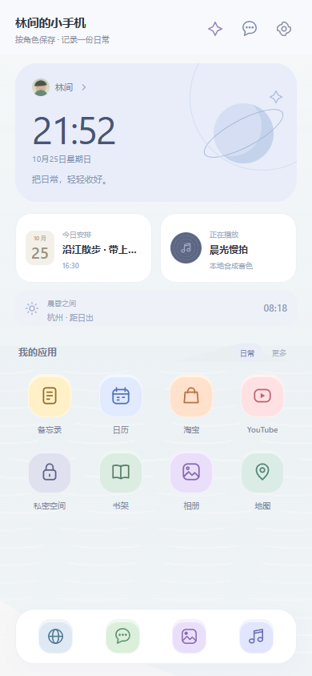

# 角色小手机

当前收录版本 **1.2.0**，需要 Skivu 0.2.38 / SDK 1.0。

- 个人主仓库、完整源码和使用说明：[skyjjgw/skivu-pocket-phone](https://github.com/skyjjgw/skivu-pocket-phone)
- 组织 Fork：[Skymoni-Labs/skivu-pocket-phone](https://github.com/Skymoni-Labs/skivu-pocket-phone)
- [发行版与安装包](https://github.com/skyjjgw/skivu-pocket-phone/releases/tag/v1.2.0)

市场仓库仅维护 `catalog/apps.json` 的收录信息，不保存该插件的业务源码或安装包。目录固定完整 Git 提交、SHA-256、字节数和完整 manifest；验证器下载有大小限制的 JSON，逐字节验证摘要、清单与许可，不执行插件代码。独立仓库 CI 从可编辑源码重建安装包并比对相同字节。审核依然需要查看源码和实际功能，摘要校验不替代代码审核。

原生 HTML/CSS/JavaScript，无前端框架、UI 依赖或额外运行时。1.2.0 全量重建界面，保留 21 个应用、42 个集合、31 个兼容工具与旧存档。安装、配置、权限、限制和来源许可详见独立仓库。

此前 1.1.0 / 1.1.1 的 Git 历史、Release 与固定提交下载链接继续保留。其历史发布记录位于 `docs/releases/`。

